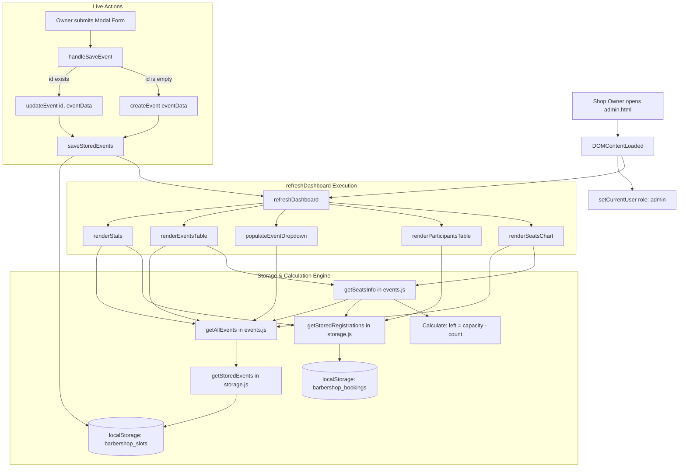

# Comprehensive Viva & Code Defense Guide: `js/events.js`, `js/storage.js`, and `admin.html`

Prepared for: **Ahsan**  
Project: **Barbershop Appointment & Management Portal (CSE326)**  
Scope: Line-by-line explanation, Data Flow Analysis, 10 Viva Questions with short answers, and 3 Live Examiner Change Tasks with exact code snippets.

---

## 1. Line-by-Line Explanation in Simple English

---

### Part A: `js/storage.js` (Data Storage & Persistence Layer)

* **Lines 1–8**: Comment header introducing `storage.js`. Explains that this file manages browser `localStorage` reading, writing, and sample seeding for barbershop service slots and client bookings.
* **Lines 10–15**: Defines `STORAGE_KEYS`, a central JavaScript configuration object holding key names:
  * `EVENTS: "barbershop_slots"` (key used to store service slots in browser memory).
  * `REGISTRATIONS: "barbershop_bookings"` (key used for client appointment bookings).
  * `CURRENT_USER: "barbershop_current_user"` (key used for active session role: customer vs shop owner).
* **Lines 17–75**: Declares `SAMPLE_EVENTS`, an array of 5 initial barbershop service slot objects (Classic Haircut, Beard Sculpt, Executive Grooming Combo, De-Tan Facial, Global Hair Color). Each has: `id`, `title`, `date`, `time`, `venue` (Chair/Barber), `description` (with price), `eligibility` (notes/policy), `category`, and `capacity`.
* **Line 78**: `function initStorage()`: Initializes and seeds localStorage if the web app is running for the very first time.
* **Line 79**: Reads existing slots data using `localStorage.getItem(STORAGE_KEYS.EVENTS)`.
* **Line 80**: Checks `if (!storedEvents)` — if no slot data exists yet in the browser.
* **Line 81**: Converts `SAMPLE_EVENTS` into a text string using `JSON.stringify()` and saves it into localStorage under `barbershop_slots`.
* **Line 83**: Reads booking data using `localStorage.getItem(STORAGE_KEYS.REGISTRATIONS)`.
* **Line 84**: Checks `if (!storedRegs)` — if no booking data exists yet.
* **Lines 86–111**: Prepares `initialRegistrations`, an array with 3 demo customer bookings (`BK-1001`, `BK-1002`, `BK-1003`) linked to `evt-1` and `evt-2` with 10-digit phone numbers.
* **Line 112**: Serializes and writes this sample booking array to `localStorage` under `barbershop_bookings`.
* **Line 114**: Ends `initStorage()` function.
* **Line 117**: `function getStoredEvents()`: Fetches the list of all service slots.
* **Line 118**: Runs `initStorage()` first so the app never returns empty or crashed data.
* **Line 119**: Retrieves the string from `localStorage`.
* **Line 120**: Ternary check: if `data` exists, converts string back to a real JavaScript array with `JSON.parse(data)`; otherwise returns an empty array `[]`.
* **Line 124**: `function saveStoredEvents(eventsArray)`: Receives an array of service slots and saves it.
* **Line 125**: Converts `eventsArray` to a JSON string and overwrites the `barbershop_slots` entry in `localStorage`.
* **Line 129**: `function getStoredRegistrations()`: Reads all customer booking records.
* **Line 130**: Calls `initStorage()`.
* **Line 131**: Gets the string from `localStorage.getItem(STORAGE_KEYS.REGISTRATIONS)`.
* **Line 132**: Returns `JSON.parse(data)` if present, or `[]`.
* **Line 135**: `function saveStoredRegistrations(registrationsArray)`: Takes updated bookings.
* **Line 136**: Converts array to JSON string and stores under `barbershop_bookings`.
* **Line 140**: `function getCurrentUser()`: Reads session user info.
* **Line 141–142**: Retrieves `barbershop_current_user` string from `localStorage` and parses it into an object, or returns `null` if no user is logged in.
* **Line 146**: `function setCurrentUser(userObject)`: Logs in or saves active user state (customer or shop owner).
* **Line 147**: Saves the user object (like `{ role: "admin", name: "Shop Owner" }`) as a JSON string.
* **Line 151**: `function clearCurrentUser()`: Logs out current user.
* **Line 152**: Deletes the `barbershop_current_user` key from `localStorage`.

---

### Part B: `js/events.js` (Business Logic for Service Slots & Capacity)

* **Lines 1–10**: File description comment header explaining the barbershop domain mapping (Events = Service Slots; Venue = Chair/Barber; Capacity = Available chairs per interval).
* **Lines 13–15**: `function getAllEvents()`: Simple abstraction helper that calls `getStoredEvents()` from `storage.js` and returns the array of service slots.
* **Lines 18–26**: `function getEventById(eventId)`:
  * Line 19: Retrieves all service slots array into `events`.
  * Lines 20–24: Loops through slots; if `events[i].id === eventId`, returns that specific slot object immediately.
  * Line 25: Returns `null` if no matching ID was found.
* **Lines 29–51**: `function getSeatsInfo(eventId)`: Calculates slot availability statistics.
  * Line 30: Looks up the slot using `getEventById(eventId)`.
  * Line 31: If slot does not exist, safely returns zeroed counts and `isFull: true`.
  * Line 33: Retrieves all bookings via `getStoredRegistrations()`.
  * Line 34: Initializes counter variable `count = 0`.
  * Lines 35–39: Loops through every booking; if `registrations[i].eventId === eventId`, increments `count++`.
  * Line 41: Converts `event.capacity` to an integer (`parseInt(..., 10) || 0`).
  * Line 42: Computes remaining slots: `left = capacity - count`.
  * Line 43: Clamps negative values: `if (left < 0) left = 0`.
  * Lines 45–50: Returns a clean status object: `{ capacity, registered: count, left, isFull: left <= 0 }`.
* **Lines 54–73**: `function createEvent(eventData)`: Adds a brand new service slot.
  * Line 55: Gets existing slots array.
  * Line 57: Generates a unique slot ID using the current millisecond timestamp (`"evt-" + Date.now()`).
  * Lines 58–68: Constructs a clean `newEvent` object, trimming strings (title, venue, description, eligibility) and parsing `capacity` to a number.
  * Line 70: Appends the new slot to the array (`events.push(newEvent)`).
  * Line 71: Commits the updated array to storage using `saveStoredEvents(events)`.
  * Line 72: Returns the newly created `newEvent` object.
* **Lines 76–93**: `function updateEvent(eventId, updatedData)`: Modifies an existing service slot.
  * Line 77: Gets existing slots array.
  * Lines 78–79: Loops through slots to find matching `eventId`.
  * Lines 80–87: Overwrites existing fields with updated, sanitized values.
  * Line 88: Commits updated list via `saveStoredEvents(events)`.
  * Line 89: Returns the modified slot object.
  * Line 92: Returns `null` if slot ID was not found.
* **Lines 96–115**: `function deleteEvent(eventId)`: Removes a service slot and cascades to its bookings.
  * Line 97: Gets all service slots.
  * Line 98: Prepares empty array `filteredEvents = []`.
  * Lines 99–103: Pushes all slots EXCEPT the one matching `eventId`.
  * Line 104: Saves the filtered array back to storage via `saveStoredEvents(filteredEvents)`.
  * Line 107: Gets all bookings.
  * Line 108: Prepares empty array `remainingRegs = []`.
  * Lines 109–113: Pushes only bookings that do NOT belong to `eventId` (cascading deletion).
  * Line 114: Saves cleaned bookings back to storage via `saveStoredRegistrations(remainingRegs)`.

---

### Part C: `admin.html` (Shop Owner Dashboard View & Controller)

* **Lines 1–11**: HTML5 document setup: DOCTYPE, language English, UTF-8 meta, responsive viewport, page title, favicon link, stylesheet link (`css/style.css`), and Chart.js CDN script import.
* **Line 12**: Opening `<body>` tag.
* **Line 15**: `<header id="app-navbar" class="navbar"></header>`: Container dynamically populated by `renderNavbar("admin")`.
* **Line 17**: Main container wrapper with inline spacing.
* **Lines 20–26**: Dashboard page heading with title, subtitle, and the `+ Add New Service Slot` button which triggers `openCreateEventModal()`.
* **Lines 29–46**: Four KPI metric cards (`stats-grid`):
  * `#stat-total-events`: displays count of all service slots.
  * `#stat-total-regs`: displays total customer bookings.
  * `#stat-total-capacity`: displays sum of all chair capacities.
  * `#stat-occupancy-rate`: displays overall percentage filled.
* **Lines 49–54**: Live Analytics card containing an HTML5 `<canvas id="seatsChart"></canvas>` where Chart.js renders the live booked vs available slots bar chart.
* **Lines 57–76**: "All Service Slots" table section with columns (Service & Barber, Service Type, Date & Time, Chair / Barber, Booking Status, Actions) and `<tbody id="admin-events-tbody">` for dynamic rendering.
* **Lines 79–91**: Customer Bookings header with service slot filtering dropdown (`#export-event-select`) that triggers `handleParticipantFilterChange()`, and the CSV export button that triggers `exportParticipantsToCSV()`.
* **Lines 93–110**: Bookings table with columns (Booking ID, Phone Number, Customer Name, Email, Service Slot, Booked At) and `<tbody id="admin-participants-tbody">`.
* **Lines 112**: Closes `<main>`.
* **Lines 115–178**: Modal popup overlay (`#event-modal`) containing the slot editor form (`#event-editor-form`) which triggers `handleSaveEvent(event)`:
  * Line 123: Hidden input `#form-event-id` (empty for new slot; holds ID when editing).
  * Lines 125–128: Service Title & Barber text input.
  * Lines 130–144: Service Type select dropdown (Haircut, Beard Trim, Shave, Hair Color, Facial, Combo) and Slot Capacity number input (min 1, max 10).
  * Lines 146–155: Slot Date input and Time text input.
  * Lines 157–160: Chair / Barber text input.
  * Lines 162–165: Requirements / Notes text input.
  * Lines 167–170: Service Description & Price textarea.
  * Lines 172–175: Modal footer with "Cancel" (`closeEventModal()`) and "Save Service Slot" submit button.
* **Line 180**: Container for toast notification alerts (`#toast-container`).
* **Line 183**: Container for footer (`#app-footer`).
* **Lines 186–189**: Script tags loading dependency order: `storage.js` -> `events.js` -> `registration.js` -> `ui.js`.
* **Lines 191–528**: Inline JavaScript controller script:
  * **Line 192**: Declares global `var chartInstance = null` to hold the Chart.js instance.
  * **Lines 194–204**: `DOMContentLoaded` event listener:
    * Checks `getCurrentUser()`; if not admin, sets session to admin role automatically so shop owner features work without manual login.
    * Calls `renderNavbar("admin")`, `renderFooter()`, and `refreshDashboard()`.
  * **Lines 207–213**: `refreshDashboard()`: Master synchronization function. Sequentially calls `renderStats()`, `renderEventsTable()`, `populateEventDropdown()`, `renderParticipantsTable()`, and `renderSeatsChart()`.
  * **Lines 216–231**: `renderStats()`: Reads `getAllEvents()` and `getStoredRegistrations()`, calculates total capacity across all slots, computes occupancy percentage `(registrations.length / totalCapacity) * 100`, and updates DOM text contents.
  * **Lines 234–275**: `renderEventsTable()`: Reads slots; if 0 slots, renders an empty state template; otherwise loops through each slot, calls `getSeatsInfo(ev.id)` to build status badges, and creates table rows with "Edit" and "Delete" buttons.
  * **Lines 278–289**: `populateEventDropdown()`: Fills `#export-event-select` with `<option value="ALL">` plus an `<option>` for each slot ID, preserving active selection.
  * **Lines 292–333**: `renderParticipantsTable()`: Reads bookings; filters by selected slot ID from dropdown; resolves slot title via `getEventById()`; formats date using `toLocaleDateString()`; and injects table rows into `#admin-participants-tbody`.
  * **Lines 335–337**: `handleParticipantFilterChange()`: Triggered when user selects a different slot in dropdown; calls `renderParticipantsTable()`.
  * **Lines 340–345**: `openCreateEventModal()`: Resets form, clears `#form-event-id`, sets modal title to "Create New Service Slot", and adds class `.active` to show modal.
  * **Lines 347–363**: `openEditEventModal(eventId)`: Fetches slot by ID, fills form fields with existing data, sets `#form-event-id` to `ev.id`, sets modal title to "Edit Service Slot Details", and opens modal.
  * **Lines 365–367**: `closeEventModal()`: Removes `.active` class to hide modal.
  * **Lines 370–403**: `handleSaveEvent(e)`:
    * Prevents default form refresh (`e.preventDefault()`).
    * Collects form values into an `eventData` object.
    * Inspects `id`:
      * If `id` exists: Calls `updateEvent(id, eventData)` from `events.js`.
      * If `id` is blank: Calls `createEvent(eventData)` from `events.js`.
    * Closes modal and calls `refreshDashboard()`.
  * **Lines 406–417**: `handleDeleteEvent(eventId)`: Shows browser `confirm()`; if confirmed, calls `deleteEvent(eventId)` and runs `refreshDashboard()`.
  * **Lines 420–478**: `renderSeatsChart()`:
    * Loops through all service slots and queries `getSeatsInfo(ev.id)`.
    * Extracts arrays for labels (slot titles truncated to 20 chars), booked slots count, and remaining available slots.
    * Calls `chartInstance.destroy()` if an existing chart was already rendered (prevents canvas memory leaks / ghost hovers).
    * Creates a stacked horizontal/vertical bar chart using Chart.js with flat palette colors (`#1F3A5F` and `#D9DEE7`).
  * **Lines 481–527**: `exportParticipantsToCSV()`:
    * Gathers filtered customer bookings list.
    * Formats CSV header: `"Booking ID,Phone Number,Customer Name,Email,Service Slot,Date Booked"`.
    * Loops over rows, sanitizes double quotes, joins with commas and newlines.
    * Creates an in-memory `Blob` of type `text/csv`, creates an invisible `<a>` download anchor, triggers `.click()`, and cleans up DOM.
* **Lines 529–530**: Closes `<script>`, `</body>`, and `</html>`.

---

## 2. End-to-End Data Flow of the Main Functions



---

## 3. Top 10 Likely Viva Questions with Short Answers

**Q1: Where is data stored in this system, and what happens when the page refreshes?**  
**Ans:** Data is stored on the client side inside the browser's `localStorage` under keys `barbershop_slots` and `barbershop_bookings`. Because `localStorage` is persistent, data remains safe and intact even when the page is refreshed or the browser is closed.

**Q2: How does `getSeatsInfo(eventId)` dynamically calculate remaining slots?**  
**Ans:** It looks up the service slot to get its total chair `capacity`, loops through all bookings from `getStoredRegistrations()` to count matching `eventId` records, and computes `left = capacity - count`. If `left <= 0`, it returns `isFull: true`.

**Q3: Why do we call `initStorage()` inside `getStoredEvents()` and `getStoredRegistrations()`?**  
**Ans:** It acts as a safety guard. If a user opens the portal on a fresh browser where `localStorage` is empty, `initStorage()` seeds 5 realistic service slots with prices and sample bookings so the UI never appears broken.

**Q4: How does `updateEvent` in `js/events.js` work when modifying a service slot?**  
**Ans:** `updateEvent(eventId, updatedData)` takes the slot ID and updated object. It iterates through the slots array, updates fields (title, category, date, time, venue, eligibility, description, capacity), saves to `barbershop_slots`, and returns the modified object.

**Q5: What is cascading deletion, and how is it implemented in `deleteEvent()`?**  
**Ans:** When a service slot is deleted from `barbershop_slots`, any client bookings referencing that slot become orphan data. `deleteEvent()` cleans both by filtering out the slot from `barbershop_slots` AND purging all bookings with matching `eventId` from `barbershop_bookings`.

**Q6: Why is `chartInstance.destroy()` called before creating a new chart in `renderSeatsChart()`?**  
**Ans:** In Chart.js, creating a new chart on a canvas that already has an active chart instance causes canvas flickering, ghost hover states, and memory leaks. Calling `.destroy()` removes the old instance before binding the new data.

**Q7: How does `exportParticipantsToCSV()` work without any backend server or PHP/Python?**  
**Ans:** It formats the bookings array into comma-separated text lines, wraps them in a JavaScript `Blob` with MIME type `text/csv`, creates an in-memory object URL with `URL.createObjectURL()`, and programmatically triggers an `<a>` tag click to download the file directly from the browser.

**Q8: Why are script tags in `admin.html` placed at the bottom and in that specific order?**  
**Ans:** Placing scripts at the bottom ensures HTML DOM elements are parsed before scripts run. The order matters because `events.js` depends on functions in `storage.js`, and `admin.html` inline script depends on both.

**Q9: What does `JSON.stringify()` and `JSON.parse()` do in `storage.js`?**  
**Ans:** `localStorage` can only store text strings. `JSON.stringify()` serializes JavaScript arrays/objects into JSON text to store them, and `JSON.parse()` deserializes JSON text back into native JavaScript objects when reading.

**Q10: How does `handleSaveEvent(e)` distinguish between creating a new slot versus editing an existing one?**  
**Ans:** It inspects the hidden input `#form-event-id`. If `#form-event-id` is empty (`""`), it is creating a new slot (`createEvent`). If it contains an ID (e.g. `"evt-1"`), it is editing an existing slot (`updateEvent`).

---

## 4. Three Small Live-Change Tasks an Examiner Might Ask

---

### Task 1: Add a New Field (e.g. `price` / "Service Fee in Rs.") Directly to Slot Cards

#### A. In `admin.html` (Form Modal)
Find the Chair / Barber `<div class="form-group">` and add the Price input right after it:
```html
<div class="form-group">
  <label class="form-label" for="form-price">Service Price (Rs.)</label>
  <input type="number" id="form-price" class="form-control" placeholder="e.g. 250">
</div>
```

#### B. In `admin.html` (`handleSaveEvent` & `openEditEventModal`)
Inside `handleSaveEvent(e)`, add `price` to `eventData`:
```javascript
var eventData = {
  title: document.getElementById("form-title").value.trim(),
  category: document.getElementById("form-category").value,
  capacity: parseInt(document.getElementById("form-capacity").value, 10),
  price: parseInt(document.getElementById("form-price").value, 10) || 0, // <--- NEW FIELD
  date: document.getElementById("form-date").value,
  time: document.getElementById("form-time").value.trim(),
  venue: document.getElementById("form-venue").value.trim(),
  eligibility: document.getElementById("form-eligibility").value.trim(),
  description: document.getElementById("form-desc").value.trim()
};
```
Inside `openEditEventModal(eventId)`, populate it:
```javascript
document.getElementById("form-price").value = ev.price || "";
```
Inside `openCreateEventModal()`, clear it:
```javascript
document.getElementById("form-price").value = "";
```

#### C. In `js/events.js` (`createEvent` & `updateEvent`)
In `createEvent(eventData)`:
```javascript
var newEvent = {
  id: newId,
  title: eventData.title.trim(),
  date: eventData.date,
  time: eventData.time,
  venue: eventData.venue.trim(),
  price: eventData.price || 0, // <--- NEW FIELD
  description: eventData.description.trim(),
  eligibility: eventData.eligibility.trim(),
  category: eventData.category,
  capacity: parseInt(eventData.capacity, 10) || 0
};
```
In `updateEvent(eventId, updatedData)`:
```javascript
events[i].price = updatedData.price || 0; // <--- NEW FIELD
```

---

### Task 2: Change Capacity Rule (e.g. Set Max Capacity to 5 Chairs & Prevent Lowering Below Active Bookings)

#### In `admin.html`:
Change the HTML input constraint in `admin.html`:
```html
<input type="number" id="form-capacity" class="form-control" min="1" max="5" placeholder="2" required>
```

#### In `admin.html` (`handleSaveEvent`):
Before saving, check if new capacity is lower than current bookings:
```javascript
if (id) {
  var currentSeats = getSeatsInfo(id);
  if (eventData.capacity < currentSeats.registered) {
    showToast("Capacity cannot be less than current bookings (" + currentSeats.registered + ")!", "danger");
    return;
  }
}
```

---

### Task 3: Add a Quick "Clear All Bookings" for a Single Service Slot in the Owner Table

#### In `admin.html`:
In `renderEventsTable()`, add a "Reset Slot" button next to "Delete":
```javascript
'<button class="btn btn-warning btn-sm" onclick="handleResetEventSeats(\'' + ev.id + '\')">Reset Slot</button>'
```

Add the handler function inside the `<script>` block in `admin.html`:
```javascript
function handleResetEventSeats(eventId) {
  if (!confirm("Clear all customer bookings for this service slot?")) return;
  var registrations = getStoredRegistrations();
  var remaining = [];
  for (var i = 0; i < registrations.length; i++) {
    if (registrations[i].eventId !== eventId) {
      remaining.push(registrations[i]);
    }
  }
  saveStoredRegistrations(remaining);
  showToast("All bookings for this slot have been cleared!", "success");
  refreshDashboard();
}
```
*(Uses exclusively existing functions `getStoredRegistrations()`, `saveStoredRegistrations()`, `showToast()`, and `refreshDashboard()`!)*
