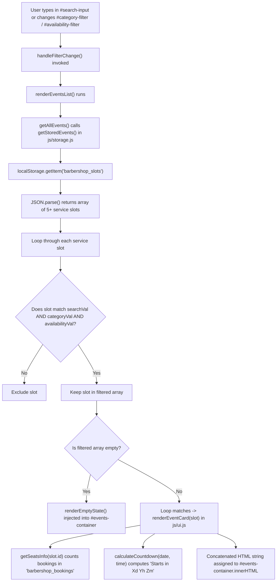

# Comprehensive Viva Voce Guide & Line-by-Line Code Analysis

**Student:** Neshwan PK  
**Project:** Barbershop Appointment & Management Portal (CSE326 Web Development)  
**Technology Stack:** Pure Standard HTML5, CSS3, Vanilla JavaScript, Browser `localStorage`  
**Deployment:** GitHub Pages (Static Web Hosting)  
**Scope of Defense:** Presentation & Interface Layer — `js/ui.js`, `css/style.css`, and `index.html`

---

## Table of Contents
1. [Overview & Barbershop Domain Architecture](#1-overview--barbershop-domain-architecture)
2. [Line-by-Line Explanation: `js/ui.js`](#2-line-by-line-explanation-jsuijs)
3. [Section-by-Section & Rule Breakdown: `css/style.css`](#3-section-by-section--rule-breakdown-cssstylecss)
4. [Line-by-Line Explanation: `index.html`](#4-line-by-line-explanation-indexhtml)
5. [Data Flow Analysis of Main Functions](#5-data-flow-analysis-of-main-functions)
6. [10 Likely Viva Voce Questions & Short Answers](#6-10-likely-viva-voce-questions--short-answers)
7. [3 Practical Live-Coding Tasks with Exact Code Changes](#7-3-practical-live-coding-tasks-with-exact-code-changes)

---

## 1. Overview & Barbershop Domain Architecture

The **Barbershop Appointment & Management Portal** is a production-grade single-page-capable web application built without complex frameworks (React, Angular), external UI libraries (Bootstrap, Tailwind), or backend databases (Node/Express, Django, MongoDB). It executes natively in any web browser and is hosted statically on GitHub Pages.

### Domain Concept Mapping:
| Original Template Concept | Barbershop Domain Equivalent | Implementation in Code |
| :--- | :--- | :--- |
| **Event** | **Service Slot** | Service time-slot (e.g. *"Classic Haircut with Rahul, Sat 11:00 AM"*) |
| **Capacity / Seats** | **Slots Available** | Capacity of 1–3 chairs per time window |
| **Venue** | **Barber / Chair** | Station identifier (e.g. *"Chair 1 - Master Barber Rahul"*) |
| **Category** | **Service Type** | Haircut, Beard Trim, Shave, Hair Color, Facial, Combo |
| **Eligibility** | **Notes / Policy** | Appointment notes (e.g. *"Walk-ins not accepted", "Arrive 5 mins prior"*) |
| **Student** | **Customer** | Validated by a 10-digit mobile phone number |
| **Registration / Ticket** | **Booking Confirmation** | Booking record with unique ID prefix `BK-` (e.g. `BK-1001`) |
| **Countdown Timer** | **Appointment Countdown** | "Starts in Xd Yh Zm" until appointment time |
| **Admin** | **Shop Owner** | Shop Owner Dashboard (`admin.html`) with KPI metrics and slot management |

### Architectural Layers:
1. **Presentation Layer (`index.html`, `event.html`, `admin.html`):** Semantic HTML5 markup, responsive layouts, data tables, filter toolbars, accessible form inputs, and modal dialogs.
2. **Design & Styling Layer (`css/style.css`):** Custom CSS3 variables (`:root`), Flexbox, CSS Grid (`repeat(auto-fill, minmax(320px, 1fr))`), clean institutional color palette (Navy `#1F3A5F`, Accent `#C8553D`, Neutral Off-White `#F5F6F8`), flat cards with subtle borders, and dedicated print styles (`@media print`).
3. **Application & Presentation Logic (`js/ui.js`):** Shared client-side rendering engine for dynamic navbar role detection, footers, toast notification queue, countdown calculations, slot cards, and empty states.
4. **Business & Domain Logic (`js/events.js`, `js/registration.js`):** Slot lookups, capacity calculation, 10-digit phone number validation, duplicate booking prevention, ticket generation (`BK-`), and cancellation handling.
5. **Persistence Layer (`js/storage.js`):** Client-side browser `localStorage` holding JSON-serialized state under `barbershop_slots`, `barbershop_bookings`, and `barbershop_current_user`.

---

## 2. Line-by-Line Explanation: `js/ui.js`

`js/ui.js` contains shared presentation helpers. Below is a line-by-line explanation of every block in the file (total 224 lines).

```javascript
1: /**
2:  * ui.js
3:  * Handles shared UI elements: navbar rendering, footer rendering, toast alerts, modals,
4:  * countdown timers, empty state cards, and service slot card generation.
...
10:  */
```
- **Lines 1–10:** Header comment defining the purpose of `ui.js` and summarizing the barbershop domain mapping.

```javascript
12: // Show in-app toast message (success, danger, warning, info)
13: function showToast(message, type) {
14:   var toastType = type || "success";
15:   var container = document.getElementById("toast-container");
16:   if (!container) {
17:     container = document.createElement("div");
18:     container.id = "toast-container";
19:     document.body.appendChild(container);
20:   }
```
- **Line 13:** Declares `showToast(message, type)` to display floating notifications.
- **Line 14:** Defaults `toastType` to `"success"` if omitted (`type || "success"`).
- **Line 15:** Searches the DOM for `<div id="toast-container">`.
- **Lines 16–20:** If not found, dynamically creates the container `<div>`, assigns ID `"toast-container"`, and appends it to `document.body`.

```javascript
22:   var toast = document.createElement("div");
23:   toast.className = "toast toast-" + toastType;
24:   toast.innerHTML = "<span>" + message + "</span>";
25: 
26:   container.appendChild(toast);
```
- **Line 22:** Creates a new `<div>` representing the toast alert.
- **Line 23:** Sets classes: `toast toast-success`, `toast toast-danger`, `toast toast-warning`, or `toast toast-info` (triggering colored left borders in CSS).
- **Line 24:** Inserts message text into `<span>` inside the toast.
- **Line 26:** Appends the toast into the container so it appears on screen.

```javascript
28:   // Auto remove after 3.5 seconds
29:   setTimeout(function() {
30:     toast.style.opacity = "0";
31:     setTimeout(function() {
32:       if (toast.parentNode) {
33:         toast.parentNode.removeChild(toast);
34:       }
35:     }, 250);
36:   }, 3500);
37: }
```
- **Lines 29–36:** After 3500ms (3.5 seconds), smoothly fades out the toast by setting `opacity = "0"`. After 250ms transition time, safely removes the DOM node using `removeChild()` to prevent memory leaks.

```javascript
39: // Render dynamic navigation bar based on logged-in role (Customer vs Shop Owner)
40: function renderNavbar(activePage) {
41:   var navEl = document.getElementById("app-navbar");
42:   if (!navEl) return;
43: 
44:   var user = getCurrentUser();
45:   var userSectionHtml = "";
```
- **Line 40:** Declares `renderNavbar(activePage)` where `activePage` identifies the current active link (`"events"`, `"my-registrations"`, or `"admin"`).
- **Lines 41–42:** Retrieves `<header id="app-navbar">`. If not on this page, exits early.
- **Line 44:** Calls `getCurrentUser()` from `storage.js` to inspect logged-in session data.
- **Line 45:** Initializes `userSectionHtml` string to hold dynamic user action buttons.

```javascript
47:   if (user) {
48:     if (user.role === "admin") {
49:       userSectionHtml = 
50:         '<span class="nav-user-badge">Shop Owner</span>' +
51:         '<a href="admin.html" class="' + (activePage === "admin" ? "active" : "") + '">Owner Dashboard</a>' +
52:         '<button class="btn btn-secondary btn-sm" onclick="handleLogout()">Logout</button>';
53:     } else {
54:       userSectionHtml = 
55:         '<span class="nav-user-badge">Customer: ' + (user.name || "Client") + ' (' + user.regNo + ')</span>' +
56:         '<a href="index.html?view=my-registrations" class="' + (activePage === "my-registrations" ? "active" : "") + '">My Bookings</a>' +
57:         '<button class="btn btn-secondary btn-sm" onclick="handleLogout()">Logout</button>';
58:     }
59:   } else {
60:     userSectionHtml = 
61:       '<button class="btn btn-secondary btn-sm" onclick="openStudentLoginModal()">Customer Login</button>' +
62:       '<button class="btn btn-primary btn-sm" onclick="openAdminLoginModal()">Owner Login</button>';
63:   }
```
- **Lines 47–52:** If logged in as `"admin"`, renders a `"Shop Owner"` badge, a link to `admin.html`, and a Logout button.
- **Lines 53–58:** If logged in as `"student"` (customer), renders a `"Customer: [Name] ([Phone])"` badge, a link to `"My Bookings"`, and a Logout button.
- **Lines 59–63:** If no user session is active, renders two clean buttons: `"Customer Login"` and `"Owner Login"`.

```javascript
65:   navEl.innerHTML = 
66:     '<div class="container nav-container">' +
67:       '<a href="index.html" class="logo">' +
68:         '<span class="logo-badge">BS</span>' +
69:         '<span>Barbershop Portal</span>' +
70:       '</a>' +
71:       '<ul class="nav-links">' +
72:         '<li><a href="index.html" class="' + (activePage === "events" ? "active" : "") + '">Browse Slots</a></li>' +
73:         (user && user.role === "student" ? '<li><a href="index.html?view=my-registrations" class="' + (activePage === "my-registrations" ? "active" : "") + '">My Bookings</a></li>' : '') +
74:         (user && user.role === "admin" ? '<li><a href="admin.html" class="' + (activePage === "admin" ? "active" : "") + '">Owner Dashboard</a></li>' : '') +
75:         '<li>' + userSectionHtml + '</li>' +
76:       '</ul>' +
77:     '</div>';
78: }
```
- **Lines 65–78:** Injects the complete navbar markup: brand logo with `"BS"` monogram and `"Barbershop Portal"` text, navigation links, and dynamic role controls.

```javascript
80: // Render consistent footer across pages
81: function renderFooter() {
82:   var footerEl = document.getElementById("app-footer");
83:   if (!footerEl) {
84:     footerEl = document.querySelector(".site-footer");
85:   }
86:   if (!footerEl) return;
...
117: }
```
- **Lines 81–117:** Mounts the shared professional footer displaying barbershop branding, system description, quick links, and team copyright information across all pages.

```javascript
119: // Helper to render reusable empty-state HTML
120: function renderEmptyState(options) {
121:   var icon = options.icon || "";
122:   var title = options.title || "No appointment slots found";
123:   var desc = options.desc || "There are no slots to display matching your criteria.";
124:   var actionBtn = options.actionBtn || "";
125: 
126:   return (
127:     '<div class="empty-state">' +
128:       (icon ? '<span class="empty-state-icon">' + icon + '</span>' : '') +
129:       '<h3 class="empty-state-title">' + title + '</h3>' +
130:       '<p class="empty-state-desc">' + desc + '</p>' +
131:       (actionBtn ? '<div class="empty-state-action">' + actionBtn + '</div>' : '') +
132:     '</div>'
133:   );
134: }
```
- **Lines 120–134:** Returns clean empty-state markup with title, description, and optional action button when no slots or bookings match filter criteria.

```javascript
136: // Helper to log out
137: function handleLogout() {
138:   clearCurrentUser();
139:   showToast("Logged out successfully.", "info");
140:   setTimeout(function() {
141:     window.location.href = "index.html";
142:   }, 500);
143: }
```
- **Lines 137–143:** Calls `clearCurrentUser()` from `storage.js`, displays a logout toast, and redirects to `index.html`.

```javascript
145: // Render dynamic countdown text (e.g. "Starts in: 3d 4h 12m" or "Slot in progress")
146: function calculateCountdown(dateString, timeString) {
147:   var target = new Date(dateString + " " + (timeString || "00:00"));
148:   if (isNaN(target.getTime())) {
149:     target = new Date(dateString);
150:   }
151:   var now = new Date();
152:   var diffMs = target.getTime() - now.getTime();
153: 
154:   if (diffMs <= 0) {
155:     return "Slot in progress or concluded";
156:   }
157: 
158:   var days = Math.floor(diffMs / (1000 * 60 * 60 * 24));
159:   var hours = Math.floor((diffMs % (1000 * 60 * 60 * 24)) / (1000 * 60 * 60));
160:   var minutes = Math.floor((diffMs % (1000 * 60 * 60)) / (1000 * 60));
161: 
162:   if (days > 0) {
163:     return "Starts in: " + days + "d " + hours + "h " + minutes + "m";
164:   }
165:   return "Starts in: " + hours + "h " + minutes + "m";
166: }
```
- **Lines 146–152:** Parses appointment slot date and time into a JavaScript `Date` object, calculates millisecond difference between target and current time (`now`).
- **Lines 154–156:** If difference is $\le 0$, gracefully returns `"Slot in progress or concluded"`.
- **Lines 158–165:** Computes days, hours, and minutes using modulo arithmetic and returns `"Starts in: Xd Yh Zm"`.

```javascript
168: // Render a single service slot card for the browsing page
169: function renderEventCard(event) {
170:   var seats = getSeatsInfo(event.id);
171:   var percentFilled = Math.round((seats.registered / seats.capacity) * 100);
172:   if (isNaN(percentFilled)) percentFilled = 0;
173: 
174:   var fillClass = "";
175:   if (percentFilled >= 90) fillClass = "fill-danger";
176:   else if (percentFilled >= 70) fillClass = "fill-warning";
```
- **Lines 169–176:** Calls `getSeatsInfo(event.id)` to determine booked slots and capacity. Computes percentage booked and assigns `fill-danger` (red) or `fill-warning` (orange) progress bar styling.

```javascript
178:   var catKey = event.category ? event.category.toLowerCase().replace(/[^a-z0-9]/g, "-") : "haircut";
179:   var categoryBadgeClass = "badge-" + catKey;
180:   
181:   var statusBadge = seats.isFull 
182:     ? '<span class="event-badge badge-full">Fully Booked</span>' 
183:     : '<span class="event-badge badge-open">' + seats.left + ' ' + (seats.left === 1 ? 'Slot Left' : 'Slots Left') + '</span>';
184: 
185:   var buttonHtml = seats.isFull
186:     ? '<button class="btn btn-secondary btn-sm" disabled>Slot Full</button>'
187:     : '<a href="event.html?id=' + encodeURIComponent(event.id) + '" class="btn btn-primary btn-sm">Book Appointment</a>';
```
- **Lines 178–179:** Normalizes category into a CSS class (e.g., `"Beard Trim"` becomes `badge-beard-trim`).
- **Lines 181–183:** Generates a `"Fully Booked"` red badge or a green `"X Slots Left"` badge.
- **Lines 185–187:** Generates a disabled `"Slot Full"` button if booked out, or an active `"Book Appointment"` button linking to `event.html?id=...`.

```javascript
189:   var countdownText = calculateCountdown(event.date, event.time);
190: 
191:   return (
192:     '<div class="event-card">' +
193:       '<div class="event-card-header">' +
194:         '<div>' +
195:           '<span class="event-badge ' + categoryBadgeClass + '">' + (event.category || "Haircut") + '</span>' +
196:           '<h3 class="event-title">' + event.title + '</h3>' +
197:         '</div>' +
198:         statusBadge +
199:       '</div>' +
200:       '<div class="event-card-body">' +
201:         '<div class="event-meta">' +
202:           '<div class="event-meta-item"><span class="event-meta-icon">Date:</span> <div><strong>' + event.date + '</strong> at ' + event.time + '</div></div>' +
203:           '<div class="event-meta-item"><span class="event-meta-icon">Barber:</span> <div>' + event.venue + '</div></div>' +
204:           '<div class="event-meta-item"><span class="event-meta-icon">Notes:</span> <div>' + event.eligibility + '</div></div>' +
205:         '</div>' +
206:         '<p class="event-desc">' + event.description + '</p>' +
207:         '<div class="countdown-box">' + countdownText + '</div>' +
208:         '<div class="seats-progress">' +
209:           '<div class="seats-label">' +
210:             '<span>Slot Capacity</span>' +
211:             '<span>' + seats.registered + ' / ' + seats.capacity + ' booked</span>' +
212:           '</div>' +
213:           '<div class="progress-bar-bg">' +
214:             '<div class="progress-bar-fill ' + fillClass + '" style="width: ' + percentFilled + '%;"></div>' +
215:           '</div>' +
216:         '</div>' +
217:       '</div>' +
218:       '<div class="event-card-footer">' +
219:         '<small class="text-muted">' + (seats.isFull ? "No slots available" : "Available now") + '</small>' +
220:         buttonHtml +
221:       '</div>' +
222:     '</div>'
223:   );
224: }
```
- **Lines 189–224:** Assembles the complete card HTML: category badge, service title, status badge, date/time, barber chair, appointment notes, price description, live countdown box, capacity progress bar, and booking button.

---

## 3. Section-by-Section & Rule Breakdown: `css/style.css`

`css/style.css` follows a professional, clean institutional design system. Below is a structured breakdown of its design tokens, rules, and layout classes:

### 1. Design Tokens & CSS Variables (`:root`, Lines 7–40)
```css
:root {
  --primary: #1F3A5F;        /* Deep Navy: Main branding, navbar, primary buttons */
  --primary-hover: #162C47;  /* Darker Navy on hover */
  --accent: #C8553D;         /* Terracotta Accent for highlights and calls to action */
  --accent-hover: #A8432D;   /* Darker Terracotta */
  --bg: #F5F6F8;             /* Neutral off-white page background */
  --surface: #ffffff;        /* Crisp white card & modal background */
  --text: #222222;           /* Charcoal primary typography */
  --text-muted: #5B6577;     /* Slate grey secondary labels */
  --border: #D9DEE7;         /* Subtle structural borders */
  --success: #2E7D32;        /* Forest green for open slots & confirmations */
  --danger: #C62828;         /* Crimson red for full slots, errors & cancellations */
  --warning: #E65100;        /* Amber for near-capacity alerts */
  --radius: 6px;             /* Strict 6px border-radius across all UI elements */
  --shadow: 0 1px 2px rgba(0, 0, 0, 0.06); /* Very faint natural shadow, NO heavy blur */
  --transition: 0.15s ease;  /* Subtle 150ms transition for clean professional feel */
}
```

### 2. Base Reset & Typography (Lines 42–79)
- Universal `box-sizing: border-box`, zero margin and padding reset.
- `font-family: system-ui, -apple-system, BlinkMacSystemFont, "Segoe UI", Roboto, ...`: System-native typography stack for zero web-font latency and crisp rendering.
- Headings set to weight `600` (no over-bolded 800/900 AI template styling).

### 3. Layout Containers & Navigation Bar (Lines 80–180)
- `.container`: Centered layout constrained to `max-width: 1140px; margin: 0 auto; padding: 0 1.25rem`.
- `.navbar`: Sticky top navigation (`position: sticky; top: 0; z-index: 100;`) with solid navy background `#1F3A5F`. No blurry backdrop filters.
- `.nav-container`: Flexbox row aligning brand logo and navigation links.
- `.logo-badge`: Compact monogram badge (`BS`) with subtle rounded styling.
- `.nav-links a`: Clean white text links with hover underline and active indicator.

### 4. Hero Section & Filter Toolbar (Lines 182–255)
- `.hero-section`: Solid navy banner `#1F3A5F` with white typography. No decorative gradients or AI blobs.
- `.filter-bar`: Flexbox container holding the search input and dropdown selects.
- `.filter-input`: 10px padded input with 1px border `#D9DEE7` and navy focus outline (`outline: 2px solid var(--primary)`).

### 5. Service Slot Cards & Grid (Lines 256–380)
- `.events-grid`: Responsive two-dimensional CSS Grid using `repeat(auto-fill, minmax(320px, 1fr))` with `1.5rem` gap.
- `.event-card`: Solid white surface, 1px border `#D9DEE7`, `border-radius: 6px`, faint shadow `0 1px 2px rgba(0,0,0,0.06)`.
- Hover behavior: Subtle border darkening (`#B8C2D3`) with a 150ms transition. No floating or scale animations.
- `.countdown-box`: Flat background `#F5F6F8` displaying live countdown text.
- `.seats-progress` & `.progress-bar-fill`: Capacity indicators with color coding: green (standard), orange (`.fill-warning` $\ge 70\%$), red (`.fill-danger` $\ge 90\%$).

### 6. Service Category Badges (Lines 381–435)
Rectangular labels with soft background tints and 1px borders:
- `.badge-haircut`: Soft blue
- `.badge-beard-trim`: Warm amber
- `.badge-shave`: Cool teal
- `.badge-hair-color`: Deep indigo
- `.badge-facial`: Soft emerald
- `.badge-combo`: Deep plum
- `.badge-open`: Forest green (`#2E7D32`)
- `.badge-full`: Solid red (`#C62828`)

### 7. Form Controls & Buttons (Lines 436–560)
- `.form-control`: 10px padding, 1px border `#D9DEE7`, 6px radius, full width.
- `.btn-primary`: Solid navy fill `#1F3A5F`, white text, 6px radius.
- `.btn-secondary`: Outline style or light grey fill.
- `.btn-danger`: Crimson fill `#C62828` for cancellation.
- Disabled buttons: Light grey background, muted text, `cursor: not-allowed`.

### 8. Data Tables & Zebra Striping (Lines 561–640)
- `.data-table`: Full-width table with light grey header `#F5F6F8`, aligned columns, and alternating zebra rows (`:nth-child(even)`).
- `.table-responsive`: `overflow-x: auto` wrapper ensuring zero horizontal overflow on mobile screens.

### 9. Modals & Toast Notifications (Lines 641–760)
- `.modal-overlay`: Plain dark overlay (`rgba(0, 0, 0, 0.5)`), no backdrop blur.
- `.modal-content`: Clean white modal container with header, body, and action footer.
- `.toast`: White box with a solid 4px left border (`--success`, `--danger`, `--warning`).

### 10. Print Media Queries (`@media print`, Lines 950–1090)
- Hides navbar, footer, buttons, search filters, and action tools (`display: none !important`).
- Formats `.ticket-wrapper` as a clean, high-contrast black-and-white booking receipt ready for physical printing or PDF saving.

---

## 4. Line-by-Line Explanation: `index.html`

`index.html` is the primary entry point containing the slot explorer, customer booking portal, and authentication modals (total 406 lines).

```html
1: <!DOCTYPE html>
2: <html lang="en">
3: <head>
4:   <meta charset="UTF-8">
5:   <meta name="viewport" content="width=device-width, initial-scale=1.0">
6:   <title>Barbershop Appointment & Management Portal</title>
7:   <link rel="icon" type="image/svg+xml" href="favicon.svg">
8:   <link rel="stylesheet" href="css/style.css">
9: </head>
```
- **Lines 1–9:** HTML5 document declaration, UTF-8 charset, responsive viewport metadata, barbershop title, barber-scissor SVG favicon link, and CSS stylesheet reference.

```html
13:   <!-- Global Navigation Header -->
14:   <header id="app-navbar" class="navbar"></header>
```
- **Lines 13–14:** Semantic `<header>` container dynamically populated by `renderNavbar()` in `ui.js`.

```html
16:   <!-- Hero Welcome Banner -->
17:   <section class="hero-section">
18:     <div class="container">
19:       <h1 class="hero-title">Book your haircut online</h1>
20:       <p class="hero-subtitle">
21:         Browse available service slots, select your preferred barber, and schedule your appointment in seconds.
22:       </p>
23:     </div>
24:   </section>
```
- **Lines 16–24:** Clean hero welcome banner setting the barbershop domain context.

```html
26:   <!-- Main Content Container -->
27:   <main class="container">
28: 
29:     <!-- Normal Service Slots Explorer View -->
30:     <div id="events-view">
```
- **Lines 26–30:** Semantic `<main>` container hosting `#events-view` (the default service slot browsing screen).

```html
31:       <!-- Search and Filter Bar -->
32:       <section class="filter-bar">
33:         <div class="search-input-wrapper">
34:           <input 
35:             type="text" 
36:             id="search-input" 
37:             class="filter-input" 
38:             placeholder="Search services or barbers..." 
39:             oninput="handleFilterChange()"
40:           >
41:         </div>
42:         <div style="flex: 0 1 200px;">
43:           <select id="category-filter" class="filter-input" onchange="handleFilterChange()">
44:             <option value="ALL">All Services</option>
45:             <option value="Haircut">Haircut</option>
46:             <option value="Beard Trim">Beard Trim</option>
47:             <option value="Shave">Shave</option>
48:             <option value="Hair Color">Hair Color</option>
49:             <option value="Facial">Facial</option>
50:             <option value="Combo">Combo</option>
51:           </select>
52:         </div>
53:         <div style="flex: 0 1 200px;">
54:           <select id="availability-filter" class="filter-input" onchange="handleFilterChange()">
55:             <option value="ALL">All Slots</option>
56:             <option value="OPEN">Available Slots Only</option>
57:             <option value="FULL">Fully Booked</option>
58:           </select>
59:         </div>
60:       </section>
```
- **Lines 32–41:** Text input with `oninput="handleFilterChange()"` for real-time live search across slot title, description, and barber chair name.
- **Lines 42–51:** Service category dropdown with options: Haircut, Beard Trim, Shave, Hair Color, Facial, and Combo.
- **Lines 52–59:** Capacity status filter: All Slots, Available Slots Only, and Fully Booked.

```html
62:       <!-- Service Slots Listing Grid -->
63:       <div id="events-container" class="events-grid">
64:         <!-- Service slot cards or empty-state injected dynamically -->
65:       </div>
66:     </div>
```
- **Lines 62–66:** Responsive CSS Grid where slot cards or empty states are injected.

```html
67:     <!-- Customer "My Bookings" View -->
68:     <div id="my-registrations-view" style="display: none; padding: 2.5rem 0;">
69:       <div style="display: flex; justify-content: space-between; align-items: center; margin-bottom: 1.5rem; flex-wrap: wrap; gap: 1rem;">
70:         <div>
71:           <h2>My Appointments & Bookings</h2>
72:           <p class="text-muted" id="student-info-heading">Track your booked appointments and visit passes.</p>
73:         </div>
74:         <a href="index.html" class="btn btn-secondary btn-sm">Back to Service Slots</a>
75:       </div>
```
- **Lines 67–75:** Customer-specific view (`#my-registrations-view`), initially hidden (`display: none`), displaying active appointments for the logged-in customer phone number.

```html
77:       <div id="my-registrations-container">
78:         <div class="table-responsive">
79:           <table class="data-table">
80:             <thead>
81:               <tr>
82:                 <th>Booking ID</th>
83:                 <th>Service Slot</th>
84:                 <th>Date & Time</th>
85:                 <th>Chair / Barber</th>
86:                 <th>Action</th>
87:               </tr>
88:             </thead>
89:             <tbody id="my-registrations-tbody">
90:               <!-- Dynamically populated -->
91:             </tbody>
92:           </table>
93:         </div>
94:       </div>
95:     </div>
```
- **Lines 77–95:** Table displaying customer booking records with columns: Booking ID (`BK-...`), Service Slot, Date & Time, Chair/Barber, and Action buttons (View Booking, Cancel Booking).

```html
100:   <!-- Customer Login Modal -->
101:   <div id="student-login-modal" class="modal-overlay">
...
112:             <label class="form-label" for="login-reg-no">Phone Number (10 digits)</label>
113:             <input type="tel" id="login-reg-no" class="form-control" placeholder="e.g. 9876543210" maxlength="10" required>
...
126:   </div>
```
- **Lines 100–126:** Customer authentication modal prompting for a 10-digit mobile phone number and customer full name.

```html
129:   <!-- Shop Owner Login Modal -->
130:   <div id="admin-login-modal" class="modal-overlay">
...
138:             <strong>Demo Credentials:</strong><br>
139:             Customer: Any 10-digit phone + name<br>
140:             Shop Owner: <code>admin</code> / <code>admin123</code>
...
157:   </div>
```
- **Lines 129–157:** Shop Owner login modal with built-in credential hints (`admin` / `admin123`) redirecting to `admin.html`.

```html
160:   <!-- Toast Container -->
161:   <div id="toast-container"></div>
162: 
163:   <!-- Shared Footer -->
164:   <footer id="app-footer" class="site-footer"></footer>
165: 
166:   <!-- Scripts -->
167:   <script src="js/storage.js"></script>
168:   <script src="js/events.js"></script>
169:   <script src="js/registration.js"></script>
170:   <script src="js/ui.js"></script>
```
- **Lines 160–170:** Mount targets for alerts and footer, followed by module loading in correct dependency order (`storage.js` $\to$ `events.js` $\to$ `registration.js` $\to$ `ui.js`).

```html
172:     // Initialize page on load
173:     document.addEventListener("DOMContentLoaded", function() {
174:       var urlParams = new URLSearchParams(window.location.search);
175:       var view = urlParams.get("view");
176: 
177:       if (view === "my-registrations") {
178:         renderNavbar("my-registrations");
179:         showMyRegistrationsView();
180:       } else {
181:         renderNavbar("events");
182:         renderEventsList();
183:       }
184:       renderFooter();
185:     });
```
- **Lines 172–188:** Page initialization router. Inspects `?view=` query parameter to either show the slot explorer or the Customer My Bookings table.

```html
191:     function renderEventsList() {
192:       var container = document.getElementById("events-container");
193:       if (!container) return;
194: 
195:       var allEvents = getAllEvents();
...
251:     }
```
- **Lines 191–251:** Primary controller function. Retrieves all slots via `getAllEvents()`, applies text search, category matching, and capacity availability filters, and injects cards or empty-state feedback.

```html
254:     function resetFilters() { ... }
262:     function handleFilterChange() { renderEventsList(); }
267:     function showMyRegistrationsView() { ... }
329:     function handleCancelMyRegistration(ticketId) { ... }
343:     function openStudentLoginModal() / closeStudentLoginModal() { ... }
350:     function openAdminLoginModal() / closeAdminLoginModal() { ... }
358:     function handleStudentLogin(e) { ... }
387:     function handleAdminLogin(e) { ... }
```
- **Lines 254–404:** Event handlers managing filter resets, customer session validation with 10-digit phone checking, booking cancellations with confirmation dialogs, and owner login checks.

---

## 5. Data Flow Analysis of Main Functions

### Data Flow Diagram: Slot Browsing & Live Filtering (`renderEventsList`)



### Data Flow: Customer Booking Workflow (`event.html`)
1. **Selection:** Customer clicks `"Book Appointment"` on a slot card $\to$ redirects to `event.html?id=evt-1`.
2. **Details Display:** `loadEventDetails()` reads slot details from `getEventById("evt-1")` and computes remaining capacity.
3. **Submission:** Customer enters 10-digit phone number, name, and email $\to$ submits `#registration-form`.
4. **Validation Pipeline (`registerStudent` in `js/registration.js`):**
   - Strips non-digits: `cleanPhone = rawPhone.replace(/\D/g, "")`.
   - Rejects if `cleanPhone.length !== 10`.
   - Checks capacity: rejects if `seats.isFull === true`.
   - Checks duplicates: rejects if customer phone already has a booking for this slot.
5. **Persistence:** Generates `ticketId = "BK-" + Math.floor(1000 + Math.random() * 9000)`, appends to `barbershop_bookings` in `localStorage`.
6. **Confirmation Slip:** Renders printed booking receipt with `BK-` ticket number, date, chair, and customer details.

---

## 6. 10 Likely Viva Voce Questions & Short Answers

### Q1: Why did you build this project using pure Vanilla JavaScript instead of React or Angular?
> **Answer:** Vanilla JavaScript runs directly in any modern browser without compilers (Babel), build tools (Webpack, Vite), or npm package dependencies. This guarantees instant page loads, zero framework vulnerabilities, simple debugging, and seamless static deployment to GitHub Pages.

### Q2: How does data persist across page refreshes without a database server like MySQL or MongoDB?
> **Answer:** Data is stored in the browser's `window.localStorage` API under specific keys (`barbershop_slots`, `barbershop_bookings`, `barbershop_current_user`). JavaScript objects are serialized into JSON strings using `JSON.stringify()` on save, and deserialized back into objects using `JSON.parse()` on retrieval.

### Q3: How is customer phone number validation enforced?
> **Answer:** In `js/registration.js` and `index.html`, we clean the input using regex `String(regNo).replace(/\D/g, "")` to extract only digits. We verify `cleanPhone.length === 10`. If the number is shorter or contains invalid characters, registration is blocked with a clear toast notification.

### Q4: How is duplicate appointment booking prevented?
> **Answer:** In `js/registration.js`, `registerStudent()` checks `isStudentAlreadyRegistered(eventId, cleanPhone)`. It iterates through all stored bookings. If a record matches both `eventId` and `regNo` (phone number), it halts execution and returns `{ success: false, message: "You already have a booking for this slot with this phone number." }`.

### Q5: How do you prevent overbooking when chair capacity is limited?
> **Answer:** In `js/events.js`, `getSeatsInfo(eventId)` dynamically counts all existing bookings for that slot. It subtracts booked count from `event.capacity`. If `seatsLeft <= 0`, `isFull` evaluates to `true`. In the UI, the booking button is disabled with text `"Slot Full"`, and `registerStudent()` rejects attempts with `"Sorry, this slot is fully booked."`.

### Q6: How does the live search filter work without refreshing the page?
> **Answer:** The search input utilizes an `oninput="handleFilterChange()"` event listener. On every keystroke, `renderEventsList()` reads the input text, converts it to lowercase, checks for substrings via `.indexOf()`, and dynamically updates `#events-container.innerHTML` without a page reload.

### Q7: How does the "Print Confirmation" feature work?
> **Answer:** The print button invokes `window.print()`. In `css/style.css`, `@media print` rules set `display: none !important` on headers, footers, search bars, and action buttons, leaving only the `.ticket-wrapper` booking slip visible for printing or PDF export.

### Q8: What is the architectural difference between CSS Flexbox and CSS Grid in this project?
> **Answer:** Flexbox is one-dimensional and is used for linear alignment in rows or columns (e.g. `.navbar`, `.filter-bar`, and card footers). CSS Grid is two-dimensional and is used in `.events-grid` with `repeat(auto-fill, minmax(320px, 1fr))` to automatically wrap cards into responsive rows and columns across mobile, tablet, and desktop viewports.

### Q9: How does the countdown timer handle slots scheduled in the past?
> **Answer:** In `calculateCountdown(dateString, timeString)` in `js/ui.js`, `target.getTime() - now.getTime()` determines the remaining millisecond difference. If `diffMs <= 0`, it returns `"Slot in progress or concluded"` rather than negative numbers.

### Q10: How does the Shop Owner export customer booking data to CSV?
> **Answer:** In `admin.html`, customer booking objects are formatted into comma-separated text rows (`\n`). We generate an in-memory `Blob` of type `text/csv`, create a temporary URL using `URL.createObjectURL(blob)`, assign it to a hidden `<a>` element with a `download` attribute, and programmatically invoke `.click()`.

---

## 7. 3 Practical Live-Coding Tasks with Exact Code Changes

During the viva defense, an examiner may ask for immediate code modifications to test your practical knowledge. Below are three likely requests with exact code snippets:

---

### Task 1: Change the Primary Brand Theme to Barber Pole Crimson
**Examiner Instruction:** *"Change the primary color theme of the portal from navy to Barber Pole Crimson."*

**Explanation:** Because `css/style.css` utilizes CSS Custom Properties (`:root`), modifying lines 8–9 instantly updates buttons, active links, focus outlines, and the navbar:

```css
/* File: css/style.css (Lines 8-9) */

/* ORIGINAL (Navy): */
--primary: #1F3A5F;
--primary-hover: #162C47;

/* CHANGE TO (Barber Pole Crimson): */
--primary: #9E1B32;
--primary-hover: #7E1528;
```
*Result:* Instantly updates the entire portal's brand color across all three pages.

---

### Task 2: Add a New Service Category Filter (e.g. "Head Massage")
**Examiner Instruction:** *"Add a new service category called 'Head Massage' to the category filter dropdown and add badge styling for it."*

**Step 1:** In `index.html`, add `<option value="Head Massage">Head Massage</option>` to the category filter:
```html
<!-- File: index.html (Around Line 50) -->
<select id="category-filter" class="filter-input" onchange="handleFilterChange()">
  <option value="ALL">All Services</option>
  <option value="Haircut">Haircut</option>
  <option value="Beard Trim">Beard Trim</option>
  <option value="Shave">Shave</option>
  <option value="Hair Color">Hair Color</option>
  <option value="Facial">Facial</option>
  <option value="Combo">Combo</option>
  <option value="Head Massage">Head Massage</option> <!-- ADD THIS LINE -->
</select>
```

**Step 2:** In `css/style.css`, add the corresponding badge styling:
```css
/* File: css/style.css (Around Line 430) */
.badge-head-massage {
  background-color: #E0F2F1;
  color: #00695C;
  border-color: #B2DFDB;
}
```
*Result:* Filtering by "Head Massage" will instantly isolate matching slots and display them with a teal badge.

---

### Task 3: Change Toast Notification Auto-Dismiss Duration
**Examiner Instruction:** *"Make floating toast notification popups dismiss faster (e.g. in 1.5 seconds instead of 3.5 seconds)."*

**Explanation:** In `js/ui.js`, locate `showToast(message, type)` at line 29 and modify the timer parameter:

```javascript
// File: js/ui.js (Lines 28-36)

// ORIGINAL:
// Auto remove after 3.5 seconds
setTimeout(function() {
  toast.style.opacity = "0";
  setTimeout(function() {
    if (toast.parentNode) {
      toast.parentNode.removeChild(toast);
    }
  }, 250);
}, 3500); // <-- 3500ms

// CHANGE TO (1.5 seconds):
setTimeout(function() {
  toast.style.opacity = "0";
  setTimeout(function() {
    if (toast.parentNode) {
      toast.parentNode.removeChild(toast);
    }
  }, 250);
}, 1500); // <-- Change 3500 to 1500
```
*Result:* All feedback toast alerts will now automatically fade out after 1.5 seconds.
